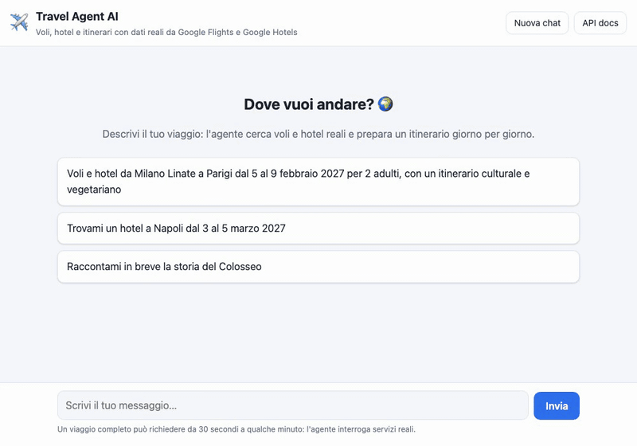
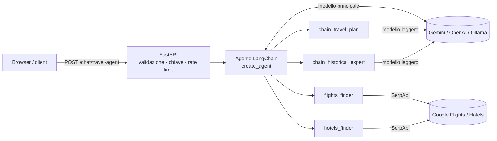

# ✈️ Travel Agent API

[](https://github.com/DarioDidonna/ai-travel-agent/actions/workflows/ci.yml)


Un **agente AI che organizza viaggi**: capisce la richiesta in linguaggio naturale, cerca **voli e hotel reali** (Google Flights e Google Hotels tramite SerpApi), prepara un **itinerario giorno per giorno** e risponde a domande storiche sulle destinazioni.

Backend in **FastAPI + LangChain**, modello **Gemini** (piano gratuito) intercambiabile con OpenAI od Ollama, con una piccola pagina di chat per provarlo dal browser.



<sub>Risposta reale dell'agente (voli da Google Flights tramite SerpApi). L'attesa è accorciata: un viaggio completo richiede di solito 30–90 secondi.</sub>

## Cosa fa

- **Agente con tool:** il modello decide da solo quali strumenti usare e con quali parametri (aeroporti IATA, date, numero di adulti…).

  | Tool | Cosa fa |
  |---|---|
  | `flights_finder` | Cerca voli reali con SerpApi (Google Flights); filtri: solo diretti, dal più economico, prezzo massimo |
  | `hotels_finder` | Cerca hotel reali con SerpApi (Google Hotels); filtri: prezzo massimo per notte, dal più economico |
  | `chain_travel_plan` | Genera un itinerario strutturato (mattina / pomeriggio / sera) con output validato da Pydantic |
  | `chain_historical_expert` | Risponde a domande storiche e culturali |

- **Conversazioni su più messaggi:** il client invia lo storico e l'agente tiene conto del contesto.
- **Risposte in italiano e in markdown**, con link di prenotazione e foto degli hotel.

## Architettura



- I tool voli e hotel passano al modello **solo i campi utili** (circa 4 KB invece di circa 160 KB per richiesta), così si resta nei limiti dei piani gratuiti e si riducono i costi.
- I tool interni usano un **modello leggero con una quota separata**, così la quota del modello principale resta per l'agente.
- Il provider si sceglie dal `.env` (`LLM_PROVIDER`), senza toccare il codice.

## Sicurezza

| Rischio | Contromisura |
|---|---|
| Prompt injection tramite messaggi `system` | Lo schema accetta solo i ruoli `user` e `assistant` |
| Input enormi o malformati | Validazione Pydantic: da 1 a 30 messaggi, fino a 4000 caratteri per l'utente (12000 per le risposte rimandate come storico) → **422** |
| Consumo illimitato in una richiesta (OWASP LLM10) | Al massimo 8 chiamate al modello e 8 ricerche per richiesta, anche se il modello ne chiede di più in parallelo; oltre → risposta con i dati raccolti o **422** |
| Argomenti dei tool scritti dal modello | Formato validato (codici IATA, date `YYYY-MM-DD`, numeri di persone): se sbagliati l'errore torna al modello, senza ricerche inutili |
| Consumo delle quote da parte di terzi | Chiave di accesso facoltativa (`X-API-Key`, confronto a tempo costante) e limite di richieste per IP → **401** / **429** |
| Fuga di chiavi negli errori | Gli errori di SerpApi (il cui URL contiene `api_key`) non arrivano né al modello né ai log; ai client arrivano solo messaggi generici |
| XSS dalle risposte del modello | Il markdown viene sanificato con DOMPurify e la pagina ha una Content Security Policy rigida (nessuno script inline) |
| Header e CORS | `nosniff`, `X-Frame-Options: DENY`, `Referrer-Policy`, `Permissions-Policy`, HSTS in produzione; origini CORS esplicite e configurabili |
| Segreti | Le chiavi stanno solo nel `.env`, escluso da git e dall'immagine Docker; `pip-audit` non rileva vulnerabilità note |
| API messa online per errore senza chiave | Con `APP_ENV=production` il server non parte senza `API_ACCESS_KEY` e `/docs` è disattivato |
| Body enormi | Oltre 1 MB → **413**, contando i byte ricevuti (non basta falsificare `Content-Length`) |
| Servizi esterni lenti | Timeout di 20 s su SerpApi (la libreria di default attende ~17 ore) e al massimo 2 tentativi verso Gemini |

## Avvio rapido

Servono una chiave [Gemini](https://aistudio.google.com) (gratuita) e una chiave [SerpApi](https://serpapi.com) (ha un piano gratuito).

### Con Docker (consigliato)

```bash
git clone https://github.com/DarioDidonna/ai-travel-agent.git
cd ai-travel-agent
cp .env.example .env        # poi inserisci GEMINI_API_KEY e SERPAPI_API_KEY
docker compose up --build
```

L'immagine usa Python 3.12, gira con un utente non root e non contiene il `.env`: le chiavi vengono passate al container all'avvio. Per usare un'altra porta: `PORT=9000 docker compose up`.

### Con Poetry

**Requisiti:** Python 3.11 o 3.12 e [Poetry](https://python-poetry.org/) 2.x.

```bash
git clone https://github.com/DarioDidonna/ai-travel-agent.git
cd ai-travel-agent
poetry install
cp .env.example .env        # poi inserisci GEMINI_API_KEY e SERPAPI_API_KEY
poetry run uvicorn travel_agent_api.main:app --reload --port 8080
```

In entrambi i casi:

- Chat: http://127.0.0.1:8080
- Documentazione interattiva dell'API: http://127.0.0.1:8080/docs
- Stato del server: http://127.0.0.1:8080/health

> Se sul sistema hai Python 3.13 o superiore, indica a Poetry una versione supportata, ad esempio:
> `poetry env use $(brew --prefix python@3.12)/bin/python3.12`.

## Configurazione (`.env`)

| Variabile | Obbligatoria | Descrizione |
|---|---|---|
| `GEMINI_API_KEY` | sì (con Gemini) | Chiave di Google AI Studio |
| `SERPAPI_API_KEY` | sì | Chiave SerpApi per voli e hotel |
| `LLM_PROVIDER` | no | `gemini` (default), `ollama` (locale, offline) oppure `openai` |
| `LLM_MODEL` | no | Modello principale (default `gemini-3.5-flash`) |
| `LLM_LIGHT_MODEL` | no | Modello per i tool interni (default `gemini-flash-lite-latest`) |
| `OPENAI_API_KEY` | solo con `openai` | Chiave OpenAI |
| `API_ACCESS_KEY` | no | Se impostata, ogni richiesta deve inviare l'header `X-API-Key` |
| `RATE_LIMIT_PER_MINUTE` | no | Richieste al minuto per IP (default 5; `0` = nessun limite) |
| `CORS_ORIGINS` | no | Origini autorizzate, separate da virgole |
| `APP_ENV` | no | `production`: richiede `API_ACCESS_KEY` all'avvio e disattiva `/docs` |
| `FORWARDED_ALLOW_IPS` | dietro un proxy | IP del proxy di cui fidarsi, per ricavare l'IP reale del client (serve al rate limit) |
| `LOG_LEVEL` | no | Livello dei log (default `INFO`): durata dei tool e delle risposte, errori dei servizi esterni |

## API

`POST /chat/travel-agent`

```json
{
  "messages": [
    { "role": "user", "content": "Vorrei andare a Napoli" },
    { "role": "assistant", "content": "Ottima scelta! Quando vorresti partire?" },
    { "role": "user", "content": "Cerca un hotel dal 3 al 5 marzo 2027" }
  ]
}
```

Risposta `200`:

```json
{ "role": "assistant", "content": "Ecco alcune opzioni di hotel a **Napoli**… 🏨" }
```

| Codice | Quando |
|---|---|
| `401` | `API_ACCESS_KEY` è impostata e l'header `X-API-Key` manca o è sbagliato |
| `422` | Messaggi non validi (ruolo, lunghezza, numero, ultimo messaggio non dell'utente) oppure richiesta che supera i limiti di consumo dell'agente |
| `413` | Richiesta oltre 1 MB |
| `429` | Limite di richieste superato; l'header `Retry-After` indica quanti secondi attendere |
| `503` | Il provider del modello non è disponibile: sovraccarico o troppe richieste (`Retry-After: 60`) oppure quota giornaliera esaurita |

Esempio con `curl`:

```bash
curl -X POST http://127.0.0.1:8080/chat/travel-agent \
  -H "Content-Type: application/json" \
  -d '{"messages":[{"role":"user","content":"Raccontami la storia del Colosseo"}]}'
```

## Test

```bash
poetry run pytest          # test e copertura
poetry run ruff check .    # lint
```

124 test automatici con **copertura del 99%**, eseguiti in meno di un secondo e **senza chiamate a servizi esterni**: l'agente, il modello e SerpApi vengono simulati. Coprono validazione, sicurezza (chiave, rate limit, CORS, header, fuga di chiavi, modalità produzione, dimensione del body), errori dei servizi esterni (timeout, chiave non valida, quote), limiti di consumo dell'agente (con l'agente LangChain reale e un modello simulato), filtri di ricerca, scelta del modello e pagina web.

La CI esegue a ogni push lint, test e copertura (minimo 90%) su Python 3.11 e 3.12, `pip-audit` e la costruzione dell'immagine Docker con un controllo su `/health`.

## Struttura del progetto

```
src/travel_agent_api/
├── main.py                    # app FastAPI, middleware (CORS, header, dimensione body), pagina di chat, /health
├── security.py                # chiave di accesso, rate limit, controlli della modalità produzione
├── llm.py                     # scelta del provider e del modello dal .env
├── routes/chat_router.py      # endpoint, validazione, gestione errori
├── services/agent_service.py  # agente LangChain e prompt di sistema
├── tools/                     # voli, hotel, itinerario, esperto storico, client SerpApi
└── static/                    # pagina di chat (HTML, CSS, JS)
tests/                         # test pytest
Dockerfile, docker-compose.yml # immagine multi-stage, utente non root, healthcheck
```

## Limiti noti

- **Quote gratuite di Gemini:** il piano gratuito ha un limite giornaliero basso (circa 20 chiamate al giorno per modello). Un viaggio completo ne usa alcune, quindi sono possibili pochi viaggi completi al giorno. Quando la quota finisce, l'API risponde `503`; si può passare a un altro modello con `LLM_MODEL`, oppure a Ollama in locale.
- **Tempi di risposta:** da circa 20 secondi a qualche minuto, a seconda del modello e del carico dei server di Google.
- **Rate limit in memoria:** vale per un singolo processo. Con più istanze servirebbe uno store condiviso (ad esempio Redis). Dietro un proxy va impostato `FORWARDED_ALLOW_IPS`, altrimenti tutti i client risultano con l'IP del proxy.
- **Camere degli hotel:** Google Hotels non permette di filtrare il numero di camere; l'agente cerca per numero di persone e lo segnala.
- **Confronti su molte date:** per restare nei limiti di consumo l'agente cerca al massimo 3–4 date per risposta e dichiara quali ha scelto.
- **Privacy:** con il piano gratuito di Gemini, Google può usare i dati inviati per migliorare i suoi prodotti; non inviare dati personali reali.

## Stack

Python 3.11/3.12 · FastAPI · LangChain 1.x · Gemini (langchain-google-genai) · SerpApi · Pydantic v2 · pytest · ruff · Poetry · Docker

## Licenza

Rilasciato con licenza [MIT](LICENSE).
